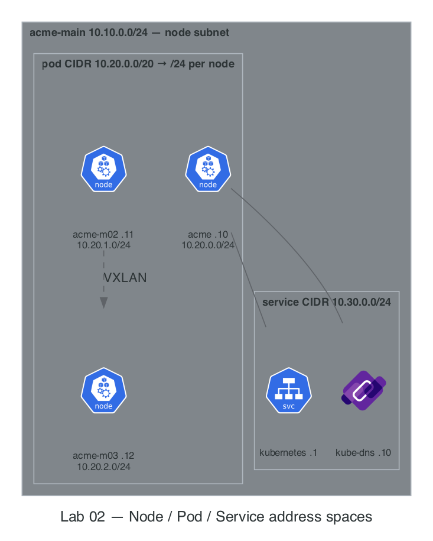

# Lab 02 · Minikube Cluster, IPAM & Cilium eBPF Dataplane

> **Core Lesson:** Design your 3 address spaces (Node, Pod, Service) before booting the cluster, attach Minikube to your existing `acme-main` VPC subnet, install **Cilium via Helm with Kubernetes IPAM and Hubble**, and prove how authorized networks control access to the Kubernetes API server.  
> **GCP Twin:** Phase P3 & P4 (`ip_allocation_policy`, `max_pods_per_node`, `datapath_provider = "ADVANCED_DATAPATH"`, `master_authorized_networks_config`).

---

## 1. Architecture Decision: IPAM & CNI Wiring

| Decision Point | Choice Made | Why It Matters on GCP GKE |
| --- | --- | --- |
| **How are Pod IPs allocated?** | `kube-controller-manager` carves `10.20.0.0/20` into `/24` per-node slices (`node.spec.podCIDR`), and Cilium runs with `ipam.mode=kubernetes`. | On GKE VPC-Native clusters, GKE carves the `gke-pods` secondary range (`10.20.0.0/20`) into per-node alias IP ranges based on `max_pods_per_node`. Using `ipam.mode=kubernetes` locally ensures your pods get `10.20.x.x` IPs instead of Cilium's private `10.0.x.x` default pool! |
| **Why install Cilium via Helm instead of `minikube start --cni=cilium`?** | Start Minikube with `--cni=bridge` (or minimal CNI), then install Cilium via Helm with `hubble.relay.enabled=true`. | Minikube's built-in `--cni=cilium` manifest uses `cluster-pool` IPAM (ignoring `10.20.0.0/20`) and disables Hubble. Installing via Helm gives you **exact CIDR parity** + **`hubble observe`** for L3/L4 packet debugging. |
| **Why 3 Nodes (`acme`, `acme-m02`, `acme-m03`)?** | 1 Control Plane (`10.10.0.10`) + 2 Workers (`acme-m02`, `acme-m03`). | Lets you test cross-node pod traffic (Lab 02), and in Lab 04 we will label `acme-m03` with `allowed-open-nat=true` (Door 3) while keeping `acme-m02` locked down. |

---

## 2. Visual Blueprint: The 3 Address Spaces & eBPF Datapath



### CIDR Capacity Math (Do This Before Every Cluster Build)

* **Pod CIDR:** `10.20.0.0/20` = $2^{32-20} = 4,096$ total IPs.
* **Per-Node Slice (Default `/24`):** $2^{32-24} = 256$ IPs per node → $\frac{4096}{256} =$ **16 nodes maximum**.
* **GKE Optimization (`max_pods_per_node = 64`):** GKE allocates a `/25` ($128$ IPs,always $2 \times \text{max\_pods}$) per node → $\frac{4096}{128} =$ **32 nodes maximum**.

---

## 3. Step-by-Step Hands-On Build

> **Commands live in `Taskfile.yml`.** Each step names its `task` (`task --list` for the full order). Remaining inline commands are verification or drills — evidence, not boilerplate.

### Step 1: Boot the 3-Node Minikube Cluster on `acme-main`

```bash
task lab02:start    # boots 'acme' on acme-main: 3 nodes, CP 10.10.0.10,
                    # pods 10.20.0.0/20, svc 10.30.0.0/24, bridge CNI
task lab01:routes   # return routes so acme-ops (probe) can reach the new nodes
```

> **The profile name is load-bearing — it must be `acme`.** `routes.sh` finds nodes by the `name.minikube.sigs.k8s.io=acme` container label, and Labs 04/10 hardcode `acme-m02`/`acme-m03`. A differently-named profile (`-p acme-cluster`) gets its own isolated docker network and silently misses every later step. If a profile exists half-built, `task clean` first.

---

### Step 2: Install Cilium CNI + Hubble (GKE Dataplane V2 Engine)

Container Network Interface (CNI) : Cilium CNI is an open-source Container Network Interface (CNI) plugin for Kubernetes
and other container orchestration platforms that provides high-performance networking, security, and observability

```bash
task lab02:cilium   # removes bridge CNI on all nodes, installs Cilium via Helm
                    # (ipam.mode=kubernetes + vxlan + Hubble), restarts CoreDNS,
                    # labels m02 pool=main and m03 pool=main allowed-open-nat=true
```

---

### Step 3: Prove the 3 Address Spaces with Evidence

Run these four commands and verify every range matches your IPAM blueprint:

```bash
task lab02:verify   # nodes -o wide + svc -A + cilium status --brief
```

What you're looking for in that output:

1. **Node IPs** `10.10.0.10/.11/.12` and per-node pod CIDRs `10.20.0.0/24`, `10.20.1.0/24`, `10.20.2.0/24` (check `.spec.podCIDR` per node).
2. **Service CIDR** — `kubernetes.default` = `10.30.0.1`, `kube-dns` = `10.30.0.10`.
3. **Pod IPs** — notice which kube-system pods show Node IPs (`10.10.0.x`) vs Pod IPs (`10.20.x.x`).

> **Architect's Observation:** Why do `kube-apiserver`, `etcd`, `kube-proxy`, and `cilium` show `10.10.0.x` (Node IP) instead of `10.20.x.x`? Because they set `hostNetwork: true`—they must run in the node's root network namespace to program the networkbefore any Pod network exists!

---

### Step 4: Configure Registry Trust on Nodes (Prep for Door 1 in Lab 03/04)

Configure `containerd` on all three Minikube nodes to allow pulling from our HTTP local registry (`10.10.0.200:5000`) on `acme-main`:

```bash
task lab02:registry   # writes containerd hosts.toml for 10.10.0.200:5000 on all 3 nodes
```

---

### Step 5: Master Authorized Networks Drill (`probe` → Control Plane API)

In Lab 01, we set `iptables -P FORWARD DROP` on `vpc-router`. Let's test whether `probe` (`10.10.1.3` in `acme-ops`) can reach the Minikube Kubernetes API server (`https://10.10.0.10:8443/version`):

```bash
# 1. Predict first: What will curl return right now? (Answer: 000 timeout — blocked by vpc-router!)
docker exec probe curl -sk -m 3 -o /dev/null -w '%{http_code}\n' https://10.10.0.10:8443/version || true

# 2. Authorize probe's IP (10.10.1.3) to reach the Control Plane on TCP 8443
#    (GCP Twin: master_authorized_networks_config cidr_blocks = ["10.10.1.3/32"])
docker exec vpc-router iptables -A FORWARD -s 10.10.1.3 -d 10.10.0.10 -p tcp --dport 8443 -j ACCEPT

# 3. Re-test: Now returns HTTP 200 (or 401/403 from apiserver RBAC, proving TCP + TLS connected!)
docker exec probe curl -sk -m 3 -o /dev/null -w 'HTTP Status: %{http_code}\n' https://10.10.0.10:8443/version
docker exec probe curl -sk https://10.10.0.10:8443/version
```

---

## 4. Deliberate Break & Triage Drills

### Drill 1: Trace Cross-Node Pod Encapsulation with `tcpdump`

Let's see how a pod on `acme-m02` (`10.20.1.x`) talks to a pod on `acme-m03` (`10.20.2.x`):

```bash
# Schedule two netshoot pods on different worker nodes
kubectl run pod-m02 --image=nicolaka/netshoot \
  --overrides='{"spec":{"nodeSelector":{"kubernetes.io/hostname":"acme-m02"}}}' -- sleep 3600
kubectl run pod-m03 --image=nicolaka/netshoot \
  --overrides='{"spec":{"nodeSelector":{"kubernetes.io/hostname":"acme-m03"}}}' -- sleep 3600
kubectl wait --for=condition=ready pod/pod-m02 pod/pod-m03 --timeout=90s

IP_M03=$(kubectl get pod pod-m03 -o jsonpath='{.status.podIP}')
echo "pod-m03 IP is $IP_M03"

# Ping from pod-m02 -> pod-m03 while inspecting Hubble
kubectl exec pod-m02 -- ping -c 2 "$IP_M03"
kubectl -n kube-system exec ds/cilium -- hubble observe --protocol icmp --last 5

# Clean up test pods
kubectl delete pod pod-m02 pod-m03 --wait=false
```

---

## 5. Readiness Gate G-02

Verify you can answer from memory:

1. Why can a second cluster on the same VPC **never** share `10.20.0.0/20` if the networks are routed together? *(Both clusters allocate overlapping `10.20.0.x` pod IPs; return traffic routes to the wrong cluster).*
2. Which Kubernetes component assigns `10.20.1.0/24` to `acme-m02`, and which component assigns `10.20.1.15` to an individual Pod on that node? *(`kube-controller-manager` assigns the `/24` `podCIDR` to the Node object; the local CNI IPAM plugin on `acme-m02` assigns individual IPs from that `/24` to Pods).*

---
**Next Step:** [Lab 03 · Services, CoreDNS & App Packaging with Docker/Helm →](lab-03-services-dns-packaging.md)
