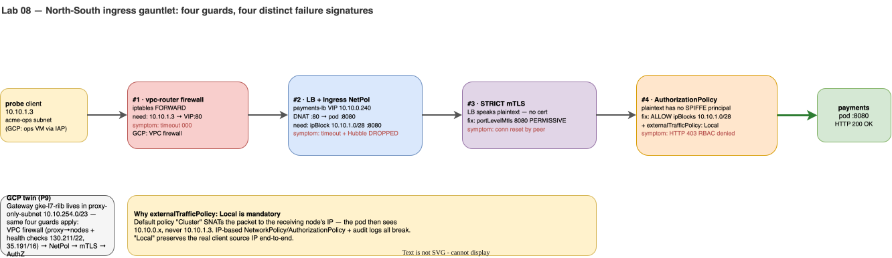

# Lab 08 · North-South Entry: MetalLB LoadBalancer & The 4-Layer Ingress Gauntlet

> **Core Lesson:** Expose an internal LoadBalancer IP (`10.10.0.240`) on `acme-main` using **MetalLB**, call it from the external `probe` bastion (`10.10.1.3` in `acme-ops`), and methodically diagnose and fix **four cascading security breaks** (Underlay Firewall → L4 NetworkPolicy → L7 STRICT mTLS → L7 SPIFFE AuthorizationPolicy).  
> **GCP Twin:** Phase P9 (`Gateway` `gke-l7-rilb`, `proxy-only-subnet` `10.10.254.0/23`, health-check firewall rules).

---

## 1. Architecture Decision: Why North-South Ingress Hits Every Guard at Once

When an external client (or Google's Regional Internal L7 Load Balancer in `proxy-only-subnet` `10.10.254.0/23`) sends an HTTP request into a zero-trust mesh workload, **four independent guards evaluate the packet in sequence**:



> **Why `externalTrafficPolicy: Local` is mandatory here:** with the default `externalTrafficPolicy: Cluster`, a node receiving traffic for `10.10.0.240` **SNATs the packet to its own Node IP (`10.10.0.10`)** before forwarding to the `orders` pod. That destroys the client's true source IP (`10.10.1.3`), breaking both audit logging and IP-based `NetworkPolicy` / `AuthorizationPolicy`! Setting `externalTrafficPolicy: Local` preserves `10.10.1.3` all the way to the pod.

---

## 2. Step-by-Step Hands-On Build

### Step 1: Install MetalLB & Allocate the Internal VIP Pool (`10.10.0.240-249`)

```bash
# 1. Install MetalLB native manifest
kubectl apply -f https://raw.githubusercontent.com/metallb/metallb/v0.14.8/config/manifests/metallb-native.yaml
kubectl -n metallb-system rollout status deploy/controller --timeout=180s
kubectl -n metallb-system rollout status ds/speaker --timeout=180s

# 2. Configure L2 IPAddressPool on acme-main (10.10.0.240 - 10.10.0.249)
kubectl apply -f - <<'EOF'
apiVersion: metallb.io/v1beta1
kind: IPAddressPool
metadata:
  name: acme-internal-pool
  namespace: metallb-system
spec:
  addresses:
    - 10.10.0.240-10.10.0.249
---
apiVersion: metallb.io/v1beta1
kind: L2Advertisement
metadata:
  name: acme-l2
  namespace: metallb-system
spec:
  ipAddressPools:
    - acme-internal-pool
EOF
```

---

### Step 2: Create the `orders-lb` LoadBalancer Service

```bash
kubectl apply -f - <<'EOF'
apiVersion: v1
kind: Service
metadata:
  name: orders-lb
  namespace: dom-orders
spec:
  type: LoadBalancer
  externalTrafficPolicy: Local
  selector:
    app: orders
  ports:
    - name: http
      port: 80
      targetPort: 8080
EOF

LB_IP=$(kubectl -n dom-orders get svc orders-lb -o jsonpath='{.status.loadBalancer.ingress[0].ip}')
echo "Assigned Internal LoadBalancer IP: $LB_IP"
```

---

### Step 3: Walk Through the 4-Layer Ingress Gauntlet (Break → Diagnose → Fix)

#### Break #1: Underlay Router Firewall Drop (`000` Timeout)

Try calling `http://$LB_IP/healthz` from `probe` (`10.10.1.3`):

```bash
docker exec probe curl -sS -m 3 -o /dev/null -w 'HTTP Code: %{http_code}\n' "http://$LB_IP/healthz" || true
# Symptom: HTTP Code: 000 (Connection timed out)
```

* **Why?** `vpc-router` (`FORWARD DROP` from Lab 01) only allows TCP `8443` to the control plane; it drops TCP `80` to `$LB_IP`.
* **Fix Break #1:** Open TCP `80` from `10.10.1.3` to `$LB_IP` on `vpc-router`:

```bash
docker exec vpc-router iptables -A FORWARD -s 10.10.1.3 -d "$LB_IP" -p tcp --dport 80 -j ACCEPT
```

---

#### Break #2: Cilium Ingress `NetworkPolicy` Drop (`000` Timeout + Hubble `DROPPED`)

Test again from `probe`:

```bash
docker exec probe curl -sS -m 3 -o /dev/null -w 'HTTP Code: %{http_code}\n' "http://$LB_IP/healthz" || true
# Symptom: Still HTTP Code: 000! Let's check Hubble:
kubectl -n kube-system exec ds/cilium -- hubble observe --to-namespace dom-orders --verdict DROPPED --last 5
```

* **Why?** The packet passed `vpc-router`, hit the worker node, was DNAT'd from `$LB_IP:80` → `orders:8080`, and was **dropped by `dom-orders` Ingress `NetworkPolicy`** — `dom-orders` has `default-deny` but *no ingress allow yet* (Lab 05 only opened ingress on `payments`/`inventory`).
* **Fix Break #2:** Allow ingress from `ipBlock: 10.10.1.0/28` on Pod port `8080` *(On GCP P9, this is `proxy-only-subnet` `10.10.254.0/23` + health-check ranges)*:

```bash
kubectl apply -f - <<'EOF'
apiVersion: networking.k8s.io/v1
kind: NetworkPolicy
metadata:
  name: allow-ops-lb-ingress
  namespace: dom-orders
spec:
  podSelector:
    matchLabels:
      app: orders
  policyTypes:
    - Ingress
  ingress:
    - from:
        - ipBlock:
            cidr: 10.10.1.0/28
      ports:
        - protocol: TCP
          port: 8080
EOF
```

---

#### Break #3: Istio `STRICT` mTLS Rejects Plaintext LB (`Connection reset by peer`)

Test again from `probe`:

```bash
docker exec probe curl -sS -m 3 -o /dev/null -w 'HTTP Code: %{http_code}\n' "http://$LB_IP/healthz" || true
# Symptom CHANGED! "curl: (56) Recv failure: Connection reset by peer"
```

* **Why?** `probe` (and any external L4/L7 LoadBalancer that isn't an Istio Ingress Gateway) speaks **plaintext HTTP**, whereas `dom-orders` has namespace-wide `PeerAuthentication: STRICT`.
* **Fix Break #3:** Apply a workload-specific `PeerAuthentication` on `orders` allowing `PERMISSIVE` on port `8080` (outbound calls from `orders` to `payments`/`inventory` still use mTLS — PERMISSIVE only relaxes *inbound*):

```bash
kubectl apply -f - <<'EOF'
apiVersion: security.istio.io/v1
kind: PeerAuthentication
metadata:
  name: orders-lb-permissive
  namespace: dom-orders
spec:
  selector:
    matchLabels:
      app: orders
  mtls:
    mode: STRICT
  portLevelMtls:
    8080:
      mode: PERMISSIVE
EOF
```

---

#### Break #4: Istio `AuthorizationPolicy` Rejects Unauthenticated Caller (`HTTP 403`)

`orders` is the *public* API — but let's lock it the way we locked `payments` in Lab 06 (SPIFFE-principals-only), which is **wrong for a north-south entrypoint**:

```bash
kubectl apply -f - <<'EOF'
apiVersion: security.istio.io/v1
kind: AuthorizationPolicy
metadata:
  name: orders-entry
  namespace: dom-orders
spec:
  action: ALLOW
  rules:
    - from:
        - source:
            principals:
              - "cluster.local/ns/dom-orders/sa/orders"   # copied the east-west pattern — WRONG here
EOF
```

Test again from `probe`:

```bash
docker exec probe curl -i -sS -m 3 "http://$LB_IP/healthz" | head -n 10
# Symptom CHANGED AGAIN! "HTTP/1.1 403 Forbidden" -> "RBAC: access denied"
```

* **Why?** `orders`' clients are **north-south IPs**, not mesh workloads — plaintext LB requests carry no SPIFFE principal, so a principals-only allow-list rejects 100% of legitimate traffic. The allow-list for a public entrypoint must be `ipBlocks`, not `principals`.
* **Fix Break #4:** Replace `orders-entry` with an `ipBlocks` rule covering `acme-ops` (which works because `externalTrafficPolicy: Local` preserved `10.10.1.3`!). On GCP this range is `proxy-only-subnet` `10.10.254.0/23`:

```bash
kubectl apply -f - <<'EOF'
apiVersion: security.istio.io/v1
kind: AuthorizationPolicy
metadata:
  name: orders-entry
  namespace: dom-orders
spec:
  action: ALLOW
  rules:
    - from:
        - source:
            ipBlocks:
              - "10.10.1.0/28"
EOF
```

Now run the final test from `probe` — not just `200`, but the **full order saga through the public door**:

```bash
docker exec probe curl -i -sS -m 3 "http://$LB_IP/healthz" | head -n 5
# Expected: HTTP/1.1 200 OK!

docker exec probe curl -sS -m 5 -X POST -H 'Content-Type: application/json' \
  -d '{"item_id":1,"qty":1}' "http://$LB_IP/orders"
# Expected: {"order_id":N,"status":"confirmed","amount":19.99}
#   -> orders called inventory (mTLS), wrote commerce-db, charged payments (mTLS):
#      every layer you built in Labs 03–07 just carried one real transaction.
```

---

## 3. Master Ingress Gauntlet Summary Table

| Step | What Was Broken | Exact Symptom from `probe` | Proof Command | Fix Applied |
| --- | --- | --- | --- | --- |
| **1** | Underlay Firewall (`vpc-router`) | `000` (`Connection timed out`) | `iptables -L FORWARD -n -v` | Allow `10.10.1.3 -> $LB_IP:80` |
| **2** | Cilium Ingress `NetworkPolicy` | `000` (`Connection timed out`) | `hubble observe --verdict DROPPED` | Allow `ipBlock: 10.10.1.0/28` on `:8080` |
| **3** | Istio `PeerAuthentication: STRICT` | `curl: (56) Connection reset by peer` | `istioctl x describe pod` | `portLevelMtls: {8080: {mode: PERMISSIVE}}` |
| **4** | Istio `AuthorizationPolicy` | `HTTP/1.1 403 Forbidden` (`RBAC: access denied`) | `kubectl logs -c istio-proxy` | Add `ipBlocks: ["10.10.1.0/28"]` (`externalTrafficPolicy: Local`) |

---
**Next Step:** [Lab 09 · GitOps Ordering with FluxCD: Controllers → Configs → Apps →](lab-09-gitops-flux-ordering.md)
