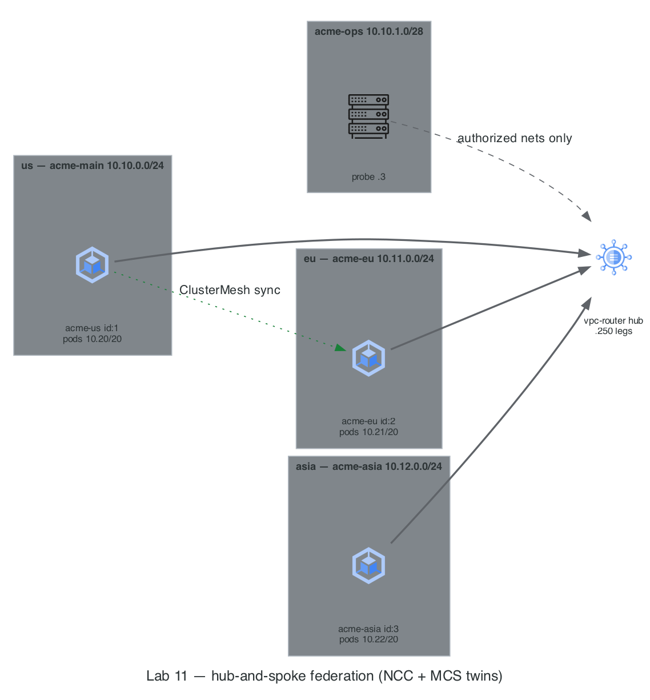

# Lab 11 · Multi-Region Federation & Cilium ClusterMesh

> **Core Lesson:** You don't *start* multi-region — you earn it. Once one region works end-to-end (Labs 01–10), stamp a second region with the same bootstrap, peer the VPCs hub-and-spoke, and merge the two clusters' service planes so a pod in `us` can discover and call a service in `eu` by its ordinary Kubernetes name.
> **GCP Twin:** Regional GKE clusters per continent + **Network Connectivity Center (NCC)** hub-spoke + **Multi-Cluster Services (MCS)** (`ServiceExport`/`ServiceImport`) + a **Fleet** of contexts (`gcloud container clusters get-credentials` per region).

---

## 1. Architecture Decision: Option B — When a Second Cluster Is Justified

ADR-01 (Reference §00) chose **1 cluster + layered zero-trust** for this lab track. This lab exercises the documented escape hatch. Read these rows *before* you build — they are what interviewers and design reviews actually probe:

| Decision Point | Choice Made | Why It Matters on GCP |
| --- | --- | --- |
| **Why a second cluster at all?** | ADR-01 Option B triggers: regulatory isolation (PCI CDE), independent upgrade cadence, or regional presence for latency/DR. | On GCP the same triggers justify `gke-us` + `gke-eu` instead of one big cluster. If none apply, Option A (namespaces + node pools) is cheaper and simpler. |
| **Domain-per-region or all-domains-everywhere?** | Domain-per-region for the lab: `orders`→us, `payments`→eu (`inventory`→asia optional). | Keeps each boundary *visible* in `kubectl get endpoints` (local `10.20.x` vs remote `10.21.x`). Production usually runs every domain in every region for latency — the machinery you learn here is identical. |
| **Why must pod CIDRs be allocated before peering?** | us `10.20.0.0/20`, eu `10.21.0.0/20`, asia `10.22.0.0/20` — reserved up front, never shared. | IPAM Golden Rule #2: overlap is silent until the day VPCs peer or NCC spokes connect — then remote pod IPs route to the *wrong* cluster and packets blackhole. |
| **How do the VPCs interconnect?** | `vpc-router` gets a leg (`10.1x.0.250`) in each regional Docker network; FORWARD opened per region-pair. `acme-ops` stays denied by default. | NCC hub-and-spoke: spokes reach each other *through the hub* — transitivity is an explicit routing/firewall decision, not a free side-effect of peering. |
| **How do clusters share services?** | **Cilium ClusterMesh** — etcd-synced endpoint propagation + `service.cilium.io/global=true` shared services. | The exact twin of **GKE Multi-Cluster Services**: annotate to export, endpoints appear fleet-wide, and draining a region drains its endpoints everywhere. |
| **Why only 2 nodes per region?** | CP + 1 worker per region (≈6 GB RAM each). | A region's redundancy story lives at the *cluster* level here; the intra-cluster node drills already ran on `us`. On GCP: per-region node pool sizing is a cost lever independent of cluster count. |

---

## 2. Visual Blueprint: The Acme Federation



### Regional IPAM (extends the Master Blueprint, Reference §00)

| Region | Profile | Node subnet (VPC) | Pod CIDR | Service CIDR | Cilium `cluster.id` | Domain |
| --- | --- | --- | --- | --- | --- | --- |
| us (hub) | `acme` | `acme-main` `10.10.0.0/24` | `10.20.0.0/20` | `10.30.0.0/24` | 1 | `orders` |
| eu | `acme-eu` | `acme-eu` `10.11.0.0/24` | `10.21.0.0/20` | `10.31.0.0/24` | 2 | `payments` |
| asia (optional) | `acme-asia` | `acme-asia` `10.12.0.0/24` | `10.22.0.0/20` | `10.32.0.0/24` | 3 | `inventory` |

> **Architect's Observation:** Every kubectl/helm/cilium command in this lab takes an explicit `--context`. One kubeconfig, one context per region — the local twin of `gcloud container clusters get-credentials` per regional cluster. Never run a bare `kubectl` in a federation; "which cluster am I pointing at?" is the #1 multi-cluster incident.

**Prerequisite:** the [Cilium CLI](https://docs.cilium.io/en/stable/gettingstarted/k8s-install-default/#install-the-cilium-cli) for mesh operations:

```bash
brew install cilium-cli        # macOS
kubectl --context acme get nodes   # expect 3 Ready — the us hub must be healthy first
```

---

## 3. Step-by-Step Hands-On Build

### Step 1: Stamp the `eu` Region

`acme-k8s-lab/region-up.sh` is the Lab 02 bootstrap parameterized by region — the same cold-rebuild muscle from Lab 10, now used as a *regional cluster factory*:

```bash
task lab11:region   # = ./acme-k8s-lab/region-up.sh eu 11 2 2
                    #   (REGION=eu OCTET=11 NODES=2 ID=2 are the task defaults)
```

Walk through what it did — each block twins a Terraform/NCC step:

1. `docker network create acme-eu` → regional VPC subnet (`google_compute_subnetwork` in `europe-west1`)
2. `docker network connect --ip 10.11.0.250 acme-eu vpc-router` → NCC spoke attachment
3. `minikube start -p acme-eu --network=acme-eu --static-ip=10.11.0.10 …` → regional GKE cluster
4. `ip route replace 10.8.0.0/13 via 10.11.0.250` on eu nodes + reciprocal `via 10.10.0.250` on `acme-main` containers → spoke routes through the hub (one `/13` covers every `acme-*` subnet, present and future)
5. `iptables FORWARD` pair rules region↔us on `vpc-router` → NCC + firewall policy; **`acme-ops` deliberately excluded** so each region still needs its own "authorized networks" punch-through
6. Cilium via Helm with `cluster.name=acme-eu cluster.id=2` → ADVANCED_DATAPATH + a fleet-unique identity

```bash
kubectl --context acme-eu get nodes -o wide    # acme-eu + acme-eu-m02, Ready
kubectl --context acme-eu get pods -n kube-system -o wide | grep cilium
```

---

### Step 2: Give the `us` Cluster a Fleet Identity

The hub cluster was installed before it had siblings — retrofit the ClusterMesh identity (unique name + id) without touching the rest of the Helm values:

```bash
task lab11:us-id   # helm --reuse-values: cluster.name=acme-us cluster.id=1 + restart

kubectl --context acme    exec -n kube-system ds/cilium -- cilium status --brief
kubectl --context acme-eu exec -n kube-system ds/cilium -- cilium status --brief
```

> **Architect's Observation:** `cluster.id` is Cilium's equivalent of a GCP fleet membership ID — it is how remote clusters distinguish whose `10.21.x` endpoints are whose. Two clusters with the same id/name cannot mesh.

---

### Step 3: Mesh the Two Clusters

```bash
task lab11:mesh   # clustermesh enable (NodePort) on both contexts + connect us->eu
                  # + waits + status on each side
```

**Expected:** each side reports the remote cluster `ready`. Behind the scenes, the `us` agents dialed `10.11.0.x:<NodePort>` *through `vpc-router`* — if your spoke routes or FORWARD pair rules were wrong, this is where it fails first (→ Drill 1).

---

### Step 4: Deploy the Domain Workloads

`payments` is deployed **in both regions** with the same name+namespace and the `global` annotation — that is what merges its endpoints into one fleet-wide service (MCS `ServiceExport` twin). `orders` lives only in `us`; it is the *caller*.

```bash
# us region: orders (caller) + a local payments replica (fallback)
kubectl --context acme create namespace orders
kubectl --context acme -n orders create deployment orders --image=nginxdemos/hello --replicas=2
kubectl --context acme -n orders expose deployment orders --port=80

kubectl --context acme create namespace payments
kubectl --context acme -n payments create deployment payments --image=nginxdemos/hello --replicas=1
kubectl --context acme -n payments expose deployment payments --port=80
kubectl --context acme -n payments annotate svc payments service.cilium.io/global=true

# eu region: payments (the domain owner)
kubectl --context acme-eu create namespace payments
kubectl --context acme-eu -n payments create deployment payments --image=nginxdemos/hello --replicas=2
kubectl --context acme-eu -n payments expose deployment payments --port=80
kubectl --context acme-eu -n payments annotate svc payments service.cilium.io/global=true
```

---

### Step 5: Prove the Federation with Evidence

```bash
# 1. The merged service: LOCAL (10.20.x) + REMOTE (10.21.x) backends side by side
kubectl --context acme -n payments get endpoints payments

# 2. Call it from the orders domain — plain service name, no DNS tricks
kubectl --context acme -n orders run caller --image=nicolaka/netshoot -- sleep 3600
kubectl --context acme -n orders exec caller -- sh -c \
  'for i in 1 2 3 4; do curl -sm3 http://payments.payments | grep -i "server name"; done'

# 3. Watch the traffic: which flows left the region?
kubectl --context acme    exec -n kube-system ds/cilium -- hubble observe --namespace payments --last 10
kubectl --context acme-eu exec -n kube-system ds/cilium -- hubble observe --namespace payments --last 10

# 4. Underlay proof: how does a us node reach the eu node subnet?
docker exec acme ip route get 10.11.0.10     # expect: via 10.10.0.250 (vpc-router)
```

> **Architect's Observation:** Nothing here used `kubectl port-forward`, `/etc/hosts`, or a shared node network. Cross-cluster pod traffic is VXLAN between *node IPs* (`10.10.x` ↔ `10.11.x`) routed through the hub — exactly how VPC-native GKE pod IPs flow across NCC spokes.

---

### Step 6: Per-Region Master Authorized Networks (Repeat of the Lab 02 Drill)

`region-up.sh` left `acme-ops`→eu denied. Authorize it explicitly — on GCP this is per-cluster `master_authorized_networks_config`, not a fleet-wide default:

```bash
docker exec probe curl -sk -m 3 -o /dev/null -w '%{http_code}\n' https://10.11.0.10:8443/version || true
# Predict: 000 — FORWARD DROP on vpc-router (ops is not a trusted spoke)

docker exec vpc-router iptables -A FORWARD -s 10.10.1.3 -d 10.11.0.10 -p tcp --dport 8443 -j ACCEPT
docker exec probe curl -sk https://10.11.0.10:8443/version
```

---

## 4. Deliberate Break & Triage Drills

### Drill 1: Sever the Spoke (NCC Route/Firewall Failure)

```bash
# Kill only the us->eu direction at the hub
docker exec vpc-router iptables -D FORWARD -s 10.10.0.0/24 -d 10.11.0.0/24 -j ACCEPT

# Predict first, then observe:
cilium clustermesh status --context acme       # remote cluster flips not-ready
kubectl --context acme -n payments get endpoints payments   # remote 10.21.x backends drained
kubectl --context acme -n orders exec caller -- curl -sm3 http://payments.payments | grep -i "server name"

# Restore the spoke
docker exec vpc-router iptables -A FORWARD -s 10.10.0.0/24 -d 10.11.0.0/24 -j ACCEPT
```

**Signature:** ClusterMesh marks the remote cluster unreachable within seconds and *drains its endpoints from every global service* — the mesh degrades gracefully to local-only backends instead of blackholing. This is the failure mode MCS replicates on GCP when a spoke disconnects.

### Drill 2: Regional Outage (DR Failover)

```bash
minikube stop -p acme-eu
kubectl --context acme -n orders exec caller -- curl -sm3 http://payments.payments | grep -i "server name"
# Expected: still 200 — served by the us-local payments replica

minikube start -p acme-eu
# REMEMBER (Lab 01): docker-exec'd routes die with the container netns — re-run the
# routes block from region-up.sh (or re-run the script; every step is idempotent).
```

### Drill 3: Predict the Overlap Trap (No Commands — Reason It Out)

You add `asia` but fat-finger the bootstrap: `pod-network-cidr=10.20.0.0/20` (same as `us`). Both clusters come up healthy in isolation. What breaks the moment ClusterMesh connects? *(Answer in the Readiness Gate.)*

---

## 5. Readiness Gate G-11

Verify you can answer from memory:

1. Why must pod CIDRs be unique **before** ClusterMesh/NCC peering, and what is the exact failure when they overlap? *(Both clusters allocate the same `10.20.x` pod IPs; remote endpoints are indistinguishable from local ones — packets for a "remote" pod route to a same-IP local pod or vanish. Isolation hides it; connectivity exposes it.)*
2. What does `service.cilium.io/global=true` twin on GCP, and where do remote endpoints actually live? *(MCS `ServiceExport`: endpoints from every fleet cluster with a same-name/namespace service are propagated into each member's service — the local `10.20.x` and remote `10.21.x` backends you saw in `kubectl get endpoints`.)*
3. When is ADR-01 Option B (N clusters) justified over Option A (1 cluster + namespaces/node pools)? *(Regulatory hard boundaries like PCI CDE, independent upgrade cadence per team, or genuine regional presence. Otherwise Option A wins on cost and east-west latency.)*
4. Why does eu→asia traffic traverse `vpc-router` instead of going direct? *(Hub-and-spoke: transitivity is an explicit FORWARD + route decision at the hub — the twin of NCC, where spoke-to-spoke connectivity flows through the hub routing config, not through implicit VPC peering.)*

---

## 6. Your Turn: The Third Region

```bash
task lab11:region REGION=asia OCTET=12 ID=3
task lab11:mesh   REGION=asia
# deploy inventory in acme-asia, annotate global, re-run Step 5
```

Note what you did *not* have to edit: the IPAM table already reserved asia's ranges, `10.8.0.0/13` already routes it, and `region-up.sh` pairs its FORWARD rules with every existing `acme-*` 10.x network. **Federation should feel boring — that's the proof the architecture was right.**

---
**Previous:** [Lab 10 · Cold Rebuild & GKE Handoff](lab-10-cold-rebuild-gke-handoff.md) · **Reference:** [ADR-01 & Master IPAM](../reference/00-architecture-decisions.md)
