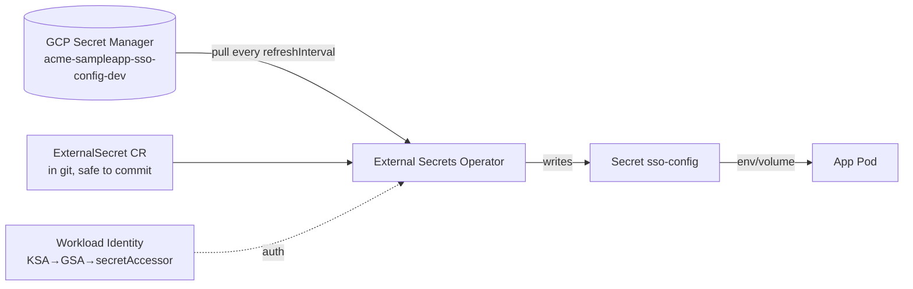

# Lab 12 · External Secrets: From "Secret in Git" to "Secret Delivered"

> **Core Lesson:** Kubernetes `Secret` objects answer *where secrets live in the cluster* — they do NOT answer *where secrets come from*. The **External Secrets Operator (ESO)** closes that gap: an `ExternalSecret` CR pulls values from an external store (GCP Secret Manager, Vault, AWS SM) into a real `Secret`, keeps it refreshed, and deletes it on teardown. You will run the full loop locally with a `fake` provider, then map it 1:1 to GCP Secret Manager + Workload Identity.
> **GCP Twin:** `acme-sampleapp-multirepo` — `infrastructure/infra/secrets.tf` creates the SM secret; this lab is the *delivery half* that lab's IAM binding already prepared.

---

## 1. Architecture Decision: Store vs Deliver

Three different questions people collapse into "secrets":

| Question | Wrong answer | Right answer |
| --- | --- | --- |
| Where does the secret *live* (source of truth)? | In the GitOps repo as base64 (base64 ≠ encryption!) | GCP Secret Manager / Vault — versioned, audited, access-controlled |
| How does it get *into* the cluster? | `kubectl create secret` by hand, or committing it | ESO `ExternalSecret` → synced `Secret` (pull model) |
| How does the app *read* it? | Mounted plaintext env (visible in `describe pod`) | env/volume from the synced Secret (still requires care — see lab 13) |

Alternatives worth naming once: **sealed-secrets** (encrypt-at-rest, decrypt-in-cluster — push model), **sops+age** (encrypt in git — lab 13), **CSI secrets-store driver** (mount, no `Secret` object at all). ESO is the one that plays best with an *existing* external store.



## 2. Step-by-Step Hands-On Build

### Step 1: Install ESO on the lab cluster

```bash
helm repo add external-secrets https://charts.external-secrets.io
helm install external-secrets external-secrets/external-secrets \
  -n external-secrets --create-namespace
kubectl -n external-secrets get pods   # controller + webhook + cert-controller
```

### Step 2: A `fake` SecretStore — the local stand-in for GCP SM

`fake` returns fixed values — perfect for learning the CRD mechanics without
cloud credentials (the rosetta-stone move: same objects, local provider).

```bash
cat << 'EOF' > fake-secretstore.yaml
apiVersion: external-secrets.io/v1
kind: ClusterSecretStore
metadata:
  name: fake-store
spec:
  provider:
    fake:
      data:
        - key: sso-config
          valueMap:
            client_id: "lab-client-123"
            client_secret: "lab-secret-456"
EOF
kubectl apply -f fake-secretstore.yaml
```

### Step 3: The `ExternalSecret` — the file you *do* commit to git

```bash
cat << 'EOF' > externalsecret.yaml
apiVersion: external-secrets.io/v1
kind: ExternalSecret
metadata:
  name: sso-config
  namespace: default
spec:
  refreshInterval: 15s
  secretStoreRef:
    name: fake-store
    kind: ClusterSecretStore
  target:
    name: sso-config            # the Secret object ESO creates/owns
    creationPolicy: Owner       # deleting the ExternalSecret deletes the Secret
  data:
    - secretKey: client_id
      remoteRef:
        key: sso-config
        property: client_id
    - secretKey: client_secret
      remoteRef:
        key: sso-config
        property: client_secret
EOF
kubectl apply -f externalsecret.yaml
kubectl get externalsecret sso-config           # STATUS: SecretSynced
kubectl get secret sso-config -o jsonpath='{.data.client_id}' | base64 -d
# lab-client-123  ← ESO created a REAL Secret from the external store
```

### Step 4: Rotation drill

```bash
kubectl edit clustersecretstore fake-store
# change client_id to "rotated-client-999" → save

# within refreshInterval (15s):
kubectl get secret sso-config -o jsonpath='{.data.client_id}' | base64 -d
# rotated-client-999  ← external store is now source of truth; rotation is a store event, not a redeploy
```

> **GCP Twin:** swap `fake-store` for `provider: gcpsm` —
> `secretID: acme-sampleapp-sso-config-dev`, auth via
> `workloadIdentity: {serviceAccountRef, clusterLocation, clusterProjectID}`.
> The GSA side already exists: `backend/infra/iam.tf` grants
> `roles/secretmanager.secretAccessor`. The `ExternalSecret` file itself is
> identical — only the store changes.

## 3. Deliberate Break & Triage

| Break | Symptom | Lesson |
| --- | --- | --- |
| Point `remoteRef.key` at a nonexistent key | `ExternalSecret` stays `SecretSyncedError`, `kubectl describe` shows provider 404 | ESO is a *reconciler* — read its events, not the Secret |
| `creationPolicy: Owner` then delete the ExternalSecret | synced `Secret` vanishes | ownership semantics — decide who owns lifecycle |
| Two `ExternalSecret`s targeting `name: sso-config` | last-writer-wins flapping | `target.name` is an exclusive claim |
| App reads env from Secret, secret rotates | pod still has old value | env vars don't hot-reload — needs rollout or volume-mount refresh strategy |

## 4. Verify

- [ ] `ExternalSecret` committed to git contains **zero secret material** — that's the whole point
- [ ] You can state: store (SM/Vault) → delivery (ESO) → consumption (env/volume) — three different layers
- [ ] You swapped `fake` → `gcpsm` mentally: what changes? (store spec + auth; nothing else)

## 5. Continue

- Lab 13 encrypts secrets *in git itself* (sops) — the alternative when there's no external store
- `terraform-concepts` reference 13 — Vault dev lab + the SM/Vault decision matrix
