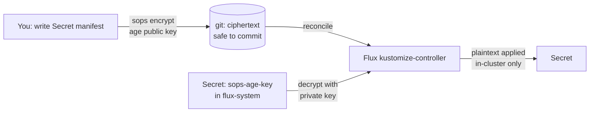

# Lab 13 · Secrets in GitOps: sops + age — Committing Secrets Safely

> **Core Lesson:** GitOps wants *everything* in git — including secrets. The resolution isn't "don't commit secrets," it's **encrypt them so the ciphertext is safe to commit**. Mozilla **sops** + **age** encrypts a Secret manifest with a key only the cluster holds; Flux decrypts it in-cluster during reconciliation. The git repo carries ciphertext; the cluster carries the key.
> **GCP Twin:** same pattern used in `flux-releases` for the rare secret that can't come from Secret Manager — the *preferable* answer in GCP is still ESO + SM (lab 12); sops covers what has no store.

---

## 1. Architecture Decision: When sops vs When ESO

| Scenario | Right tool | Why |
| --- | --- | --- |
| Secret already lives in SM/Vault (SSO config, DB creds) | **ESO** (lab 12) | store is source of truth; rotation = store event |
| Small, app-owned secret with no external store (API key for a lab webhook) | **sops+age** | ciphertext is safe in git; no infra to run |
| Cluster-wide sealed secrets, multi-cluster portability | sealed-secrets alternative | per-cluster cert; simpler but no KMS integration |



## 2. Step-by-Step Hands-On Build

### Step 1: Generate the age keypair — private goes to the cluster, never to git

```bash
brew install sops age   # if needed

age-keygen -o age.key
# Public key: age1abc...   (shareable — this is what you encrypt TO)

# Private half lives ONLY in the cluster:
kubectl create secret generic sops-age-key \
  --namespace=flux-system \
  --from-file=age.agekey=age.key

# add to .gitignore immediately:
echo "age.key" >> ~/acme-k8s-lab/gitops/.gitignore
```

### Step 2: Configure sops defaults (`.sops.yaml` in the gitops repo)

```bash
cat << 'EOF' > ~/acme-k8s-lab/gitops/.sops.yaml
creation_rules:
  - path_regex: .*.yaml
    encrypted_regex: ^(data|stringData)$    # encrypt ONLY values under data: — keys stay readable
    age: age1abc...                          # your public key from step 1
EOF
```

`encrypted_regex` is the pro move: only `data:`/`stringData:` gets encrypted,
so `git diff` still shows *which keys exist* — reviewers can see the shape
without seeing values.

### Step 3: Encrypt and commit a secret

```bash
cat << 'EOF' > ~/acme-k8s-lab/gitops/infrastructure/data/db-creds.yaml
apiVersion: v1
kind: Secret
metadata:
  name: db-creds
  namespace: dom-data
stringData:
  password: "correct-horse-battery-staple"
EOF

cd ~/acme-k8s-lab/gitops
sops --encrypt --in-place infrastructure/data/db-creds.yaml

cat infrastructure/data/db-creds.yaml
# stringData:
#   password: ENC[AES256_GCM,data:...,iv:...,tag:...,type:str]
# sops:
#   age: ...
#   lastmodified: ...
```

Commit it — the file is ciphertext. This is the "aha": `git log` holds
secrets forever *and it's fine*, because the key isn't in the repo.

### Step 4: Tell Flux to decrypt during apply

Extend the lab-09 `25-data` kustomization with `decryption`:

```yaml
apiVersion: kustomize.toolkit.fluxcd.io/v1
kind: Kustomization
metadata:
  name: data
  namespace: flux-system
spec:
  interval: 5m
  dependsOn: [infra-configs]
  path: ./infrastructure/data
  prune: true
  wait: true
  sourceRef:
    kind: GitRepository
    name: flux-system
  decryption:                    # ← new
    provider: sops
    secretRef:
      name: sops-age-key         # the private key from step 1
```

```bash
git add -A && git commit -m "Encrypt db-creds, enable sops decryption"
git push && flux reconcile kustomization data
kubectl -n dom-data get secret db-creds -o jsonpath='{.data.password}' | base64 -d
# correct-horse-battery-staple  ← plaintext exists ONLY in the cluster
```

## 3. Deliberate Break & Triage

| Break | Symptom | Lesson |
| --- | --- | --- |
| Delete `sops-age-key` secret, re-reconcile | kustomization fails: `decryption failed` | the key is cluster state — rebuild drills must restore it (ties to lab-10 cold rebuild) |
| Commit the *unencrypted* yaml by accident | plaintext in git history | secret is burned → rotate + `git rm`; this is why `.sops.yaml` defaults + pre-commit sops checks exist |
| Encrypt the whole file (no `encrypted_regex`) | `no matches for kind Secret` style errors — apiVersion/kind encrypted | only values may be ciphertext; metadata must stay readable |
| Push key+secret in one commit, revoke key later | old commits still decrypt with old key | rotate key = re-encrypt all files (`sops updatekeys`); plaintexts from old commits stay readable to anyone with old key — rotate secrets too |

## 4. Verify

- [ ] A committed `Secret` in the gitops repo decrypts to the right value in-cluster
- [ ] `git log -p` shows only ciphertext for `db-creds.yaml`
- [ ] You can state the full trust chain: age pubkey in `.sops.yaml` → ciphertext in git → private key in `flux-system` → Flux decrypts at apply
- [ ] You can name when ESO (lab 12) is the *better* answer

## 5. Continue

- Lab 12 — the pull-model alternative (external store as source of truth)
- `DevOpsLearning` theory 13 — the full secrets taxonomy
