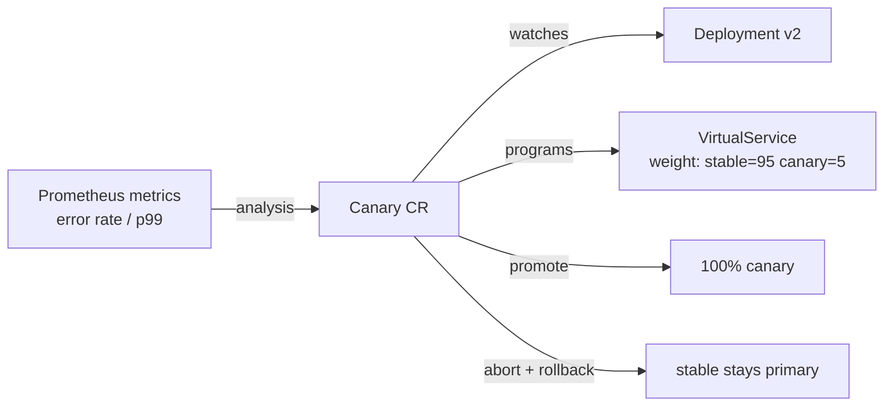

# Lab 14 · Progressive Delivery: Canary with Flagger + Istio

> **Core Lesson:** A rolling update answers "did it deploy?"; progressive delivery answers "is it *good*?" — before the blast radius reaches everyone. **Flagger** drives a metric-gated canary on top of the Istio mesh from lab 06: shift 5%→25%→50%→100% of traffic, watch Prometheus request metrics, and **abort automatically** on error-rate or latency regression.
> **GCP Twin:** the same Flagger + managed-metrics pattern works on GKE; the GitOps-friendly part is that the `Canary` CR lives in your release repo.

---

## 1. Architecture Decision: Rolling vs Blue-Green vs Canary

| Strategy | How | When it lies to you |
| --- | --- | --- |
| **Rolling** (Deployment default) | replace pods gradually, all traffic hits new pods immediately | your "10% of replicas" canary IS 10% of requests — no control, no metric gate |
| **Blue-green** | two full envs, switch traffic at the edge | doubles capacity cost; switch is still a cliff |
| **Canary** (Flagger/Argo Rollouts) | weighted traffic split + metric gate + auto-promote/abort | needs a traffic-shifting layer (Istio/Gateway API/ingress) + metrics |



## 2. Step-by-Step Hands-On Build

### Step 1: Install Flagger (onto the lab's Istio mesh)

```bash
helm repo add flagger https://flagger.app
helm install flagger flagger/flagger \
  -n istio-system \
  --set meshProvider=istio \
  --set metricsServer=http://prometheus-operated:9090   # lab-07's Prometheus
```

### Step 2: The `Canary` resource — the whole lesson in one file

```bash
cat << 'EOF' > canary-orders.yaml
apiVersion: flagger.app/v1beta1
kind: Canary
metadata:
  name: orders
  namespace: dom-apps
spec:
  targetRef:
    apiVersion: apps/v1
    kind: Deployment
    name: orders
  service:
    port: 80
  analysis:
    interval: 30s
    threshold: 5            # abort after 5 failed metric checks
    maxWeight: 50           # never exceed 50% canary traffic
    stepWeight: 10          # 10% steps: 10→20→...→50→promote
    metrics:
      - name: request-success-rate
        thresholdRange:
          min: 99           # % — abort if success < 99%
        interval: 1m
      - name: request-duration
        thresholdRange:
          max: 500          # ms p99 — abort if slower
        interval: 30s
EOF
kubectl apply -f canary-orders.yaml
```

Flagger clones your Deployment into `orders-primary` (stable) and lets the
original `orders` deployment be the canary target. **A new image tag on
`orders` is now a canary trigger, not a deploy.**

### Step 3: Trigger and watch

```bash
kubectl set image deployment/orders app=orders:v2-bad -n dom-apps
kubectl -n dom-apps get canary orders -w
# STATUS: Progressing → weight 10 → 20 → ... Failed (metric breached) → rollback
```

Flagger writes its decisions as events — `kubectl describe canary orders`
shows the exact metric that breached and the rollback it performed.

### Step 4: Blue-green (simpler cousin) via Gateway API

Set `spec.analysis.iterations` instead of weights, or run the classic two-
deployment pattern: `orders-blue` + `orders-green` behind one Service,
switch the Service selector. Cheaper mentally, pricier in capacity — be
able to explain both.

## 3. Deliberate Break & Triage

| Break | Symptom | Lesson |
| --- | --- | --- |
| Deploy v2 that returns 500s on /orders | canary aborts at first metric check; stable untouched | **this is the product** — the blast radius was 5% of traffic for 30s |
| Wrong `metricsServer` URL | analysis stalls at Progressing, no metrics | Flagger's gate is only as good as its metric source — check `describe` events |
| `kubectl rollout undo` during analysis | two controllers fighting the same Deployment | the Canary CR owns the rollout now — revert via git/image tag |
| threshold: 0 | analysis never runs, instant promote | thresholds are the gate — zero means "rolling update with extra steps" |

## 4. Verify

- [ ] A bad release was killed by metrics at ≤10% traffic — prove it with `describe canary`
- [ ] You can draw stable/canary/VirtualService and explain who owns the weight
- [ ] You can compare Flagger vs Argo Rollouts in one line (Rollouts: dashboard + built-in analysis, heavier; Flagger: CRD-light, provider-agnostic)
- [ ] You know why this composes with GitOps: the `Canary` is just another manifest Flux reconciles

## 5. Continue

- Lab 13's sops secret + this lab's Canary + lab 09's Flux ordering = the full GitOps delivery story
- `gitlab-spring-app-flux` lesson 06 — the push-model deploy this replaces for prod
