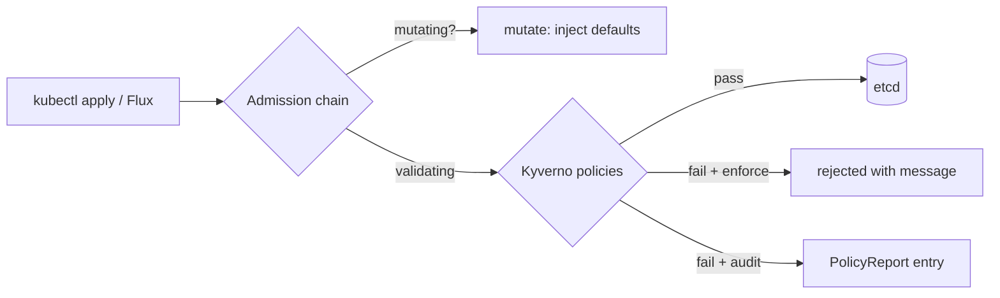

# Lab 18 · Policy-as-Code: Kyverno Admission Policies

> **Core Lesson:** Labs 05–06 enforced rules at the *network* layer; lab 17 granted *API access*. **Kyverno** enforces rules about *what objects may exist at all* — a validating/mutating admission controller whose policies are YAML, not Rego. Required labels, no `:latest`, only signed images, resource limits mandatory: the tribal-knowledge checklist becomes executable policy.
> **GCP Twin:** GKE Policy Controller (Gatekeeper/OPA) is the managed equivalent — same idea, different DSL (Rego vs Kyverno's YAML).

---

## 1. Architecture Decision: Audit → Enforce

| Mode | Behavior | Use |
| --- | --- | --- |
| `audit` | violations logged in `PolicyReport`, object admitted | **always start here** — see the blast radius before enforcing |
| `enforce` | violating objects rejected at admission | flip after the report is clean |



## 2. Step-by-Step Hands-On Build

### Step 1: Install

```bash
helm install kyverno kyverno/kyverno -n kyverno --create-namespace
kubectl -n kyverno get pods    # admission + background + cleanup controllers
```

### Step 2: Three teaching policies — the checklist made executable

```bash
cat << 'EOF' > policies.yaml
apiVersion: kyverno.io/v1
kind: ClusterPolicy
metadata: {name: require-labels}
spec:
  validationFailureAction: audit          # START IN AUDIT — always
  rules:
    - name: require-app-label
      match:
        any: [{resources: {kinds: [Deployment, StatefulSet]}}]
      validate:
        message: "app.kubernetes.io/name label required"
        pattern:
          metadata:
            labels:
              app.kubernetes.io/name: "?*"
---
apiVersion: kyverno.io/v1
kind: ClusterPolicy
metadata: {name: disallow-latest-tag}
spec:
  validationFailureAction: audit
  rules:
    - name: no-latest
      match:
        any: [{resources: {kinds: [Pod]}}]
      validate:
        message: "image tag 'latest' is forbidden — pin a version"
        pattern:
          spec:
            =(ephemeralContainers): "X"
            containers:
              - image: "!*:latest"
---
apiVersion: kyverno.io/v1
kind: ClusterPolicy
metadata: {name: require-resource-limits}
spec:
  validationFailureAction: audit
  rules:
    - name: require-limits
      match:
        any: [{resources: {kinds: [Pod]}}]
      validate:
        message: "cpu/memory limits required"
        pattern:
          spec:
            containers:
              - resources:
                  limits:
                    memory: "?*"
                    cpu: "?*"
EOF
kubectl apply -f policies.yaml
```

### Step 3: Generate violations, read the report

```bash
kubectl run bad-pod --image=nginx:latest     # violates 2 of 3 policies
kubectl get policyreport -A                  # audit findings land here
kubectl describe clusterpolicyreport | grep -A3 "Result: fail"
```

### Step 4: Flip to enforce — now the admission rejects

```bash
kubectl patch clusterpolicy disallow-latest-tag --type=json \
  -p '[{"op":"replace","path":"/spec/validationFailureAction","value":"enforce"}]'

kubectl run bad-pod2 --image=nginx:latest
# Error: admission webhook denied the request: image tag 'latest' is forbidden
```

### Step 5: Signed images only (closes the Phase-2 cosign loop)

Kyverno's `verifyImages` rule checks cosign signatures at admission — the
deploy-time enforcement of what you signed in CI:

```yaml
# rule sketch — verify signature identity before admitting:
# verifyImages:
#   - image: "*"
#     keyless:
#       subject: "https://gitlab.com/<group>/<repo>//.gitlab-ci.yml"
#       issuer: "https://gitlab.com"
```

## 3. Deliberate Break & Triage

| Break | Symptom | Lesson |
| --- | --- | --- |
| Enforce `require-labels` before fixing existing deployments | new ReplicaSets rejected on rollout | audit-first isn't politeness — enforce blocks *transitions*, not just new objects |
| Policy matches `Pod` but Flux applies `Deployment` | reports on pods only — deployment admitted | match at the controller level you actually apply |
| `failurePolicy: Fail` webhook + kyverno down | all admissions blocked → cluster wedged | webhooks are in the control path; audit/failurePolicy decisions are availability decisions |
| Pattern `!*:latest` on a digest ref | digest refs (`@sha256:`) bypass tag rules | tag policies need digest-awareness; signed-image rules close the hole |

## 4. Verify

- [ ] A `PolicyReport` read and explained (who violated, which rule, when)
- [ ] audit→enforce rollout plan stated cold
- [ ] Kyverno vs Gatekeeper in one line (YAML/CEL-style vs Rego DSL)
- [ ] You can name a mutating vs validating admission difference (Istio's
      sidecar injector is mutating; policies above validate)

## 5. Continue

- `gitlab-spring-app-flux` security stage + this lab = sign-in-CI → verify-at-admission, the complete supply-chain loop
