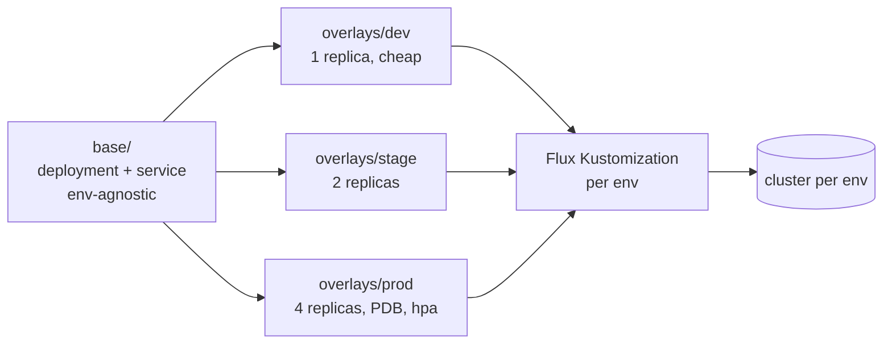

# Lab 19 · Kustomize & Multi-Environment Promotion

> **Core Lesson:** You've met the Flux `Kustomization` *CRD* (lab 09). Now meet **kustomize the tool** — template-free YAML customization: a shared `base/` + per-env `overlays/` that patch replicas, resources, and config *without copy-pasting YAML*. Then wire it to promotion: the same base flows dev→stage→prod through Flux, each overlay being one auditable diff.
> **GCP Twin:** this is exactly the release-repo shape Flux estates use — `base/` + `overlays/<env>` reconciled by per-cluster Kustomizations.

---

## 1. Architecture Decision: Kustomize vs Helm

| | Helm | Kustomize |
| --- | --- | --- |
| Model | templates + values | base YAML + patches |
| Best at | distributing apps (charts, versions, registries) | **env promotion of your own manifests** — overlays are diffs, not templates |
| Danger | template sprawl | patch drift (patch references a field that moved) |

They compose: Flux renders `helmChart` then kustomizes the output —
`valuesFrom` in a HelmRelease is already this idea.



## 2. Step-by-Step Hands-On Build

### Step 1: The base — deliberately *incomplete*

```bash
mkdir -p ~/acme-k8s-lab/promo/{base,overlays/{dev,stage,prod}}

cat << 'EOF' > ~/acme-k8s-lab/promo/base/kustomization.yaml
apiVersion: kustomize.config.k8s.io/v1beta1
kind: Kustomization
resources: [deployment.yaml, service.yaml]
commonLabels: {app: orders}
EOF

cat << 'EOF' > ~/acme-k8s-lab/promo/base/deployment.yaml
apiVersion: apps/v1
kind: Deployment
metadata: {name: orders}
spec:
  selector: {matchLabels: {app: orders}}
  template:
    metadata: {labels: {app: orders}}
    spec:
      containers:
        - name: app
          image: orders-api:1.4.0
          ports: [{containerPort: 8080}]
EOF
```

> Design rule: the base carries only what's TRUE for every env — never a
> replica count, never a resource limit, never a hostname.

### Step 2: Overlays — each env is a diff, nothing more

```bash
cat << 'EOF' > ~/acme-k8s-lab/promo/overlays/dev/kustomization.yaml
apiVersion: kustomize.config.k8s.io/v1beta1
kind: Kustomization
resources: [../../base]
namespace: dev
patches:
  - patch: |-
      - op: replace
        path: /spec/replicas
        value: 1
    target: {kind: Deployment, name: orders}
images:
  - name: orders-api
    newTag: dev-latest
EOF

cat << 'EOF' > ~/acme-k8s-lab/promo/overlays/prod/kustomization.yaml
apiVersion: kustomize.config.k8s.io/v1beta1
kind: Kustomization
resources: [../../base]
namespace: prod
patches:
  - patch: |-
      - op: replace
        path: /spec/replicas
        value: 4
    target: {kind: Deployment, name: orders}
  - patch: |-
      - op: add
        path: /spec/template/spec/containers/0/resources
        value: {requests: {cpu: 200m, memory: 256Mi}, limits: {cpu: "1", memory: 512Mi}}
    target: {kind: Deployment, name: orders}
images:
  - name: orders-api
    newTag: "1.4.0"
EOF
```

### Step 3: `kustomize build` — promotion previewed before any cluster

```bash
kustomize build overlays/dev  | grep -E "replicas|namespace|image:"
kustomize build overlays/prod | grep -E "replicas|namespace|image:"

diff <(kustomize build overlays/dev) <(kustomize build overlays/prod)
# ← THE answer to "what's different between dev and prod": one diff, auditable in git
```

### Step 4: Wire to Flux — one Kustomization per env

```yaml
# clusters/prod/30-apps.yaml — the prod cluster's Flux Kustomization:
spec:
  path: ./promo/overlays/prod      # THIS cluster reconciles the prod overlay
  # dev cluster's Kustomization points at ./promo/overlays/dev — same repo
```

Promotion = merge the same base change; each cluster's kustomization picks
it up through its own overlay — the image pin in `images:` is what makes
prod move *only when you choose*.

## 3. Deliberate Break & Triage

| Break | Symptom | Lesson |
| --- | --- | --- |
| Patch targets `name: orders` after base renames it | `no resource matches strategic merge patch` | patches are name/namespace/type-coupled — renames cascade |
| Put `replicas: 1` in the base | prod overlay inherits it; prod silently runs 1 replica | **base stays env-agnostic** — the rule that prevents real incidents |
| `resources:` patch missing a required field | `kustomize build` fails fast | build locally in CI — promotion diffs are CI-checkable artifacts |
| Direct-edit a prod namespace in an overlay | kubectl applies to wrong ns | `namespace:` in overlay pins everything; mixing namespaces in one overlay is a smell |

## 4. Verify

- [ ] `diff` of dev vs prod builds understood as "the env contract"
- [ ] You can state kustomize vs helm in the one-table answer
- [ ] A promotion traced: base merge → overlay → Flux kustomization → cluster
- [ ] You know why `newTag` per overlay = the promotion gate

## 5. Continue — the capstone

You now own every piece of the loop. `gitlab-spring-app-flux`
`docs/07-capstone.md` strings them together: commit → test → build → scan →
sign → package → gated deploy → canary → rollback — one pipeline, every
phase of this curriculum visible in one file.
